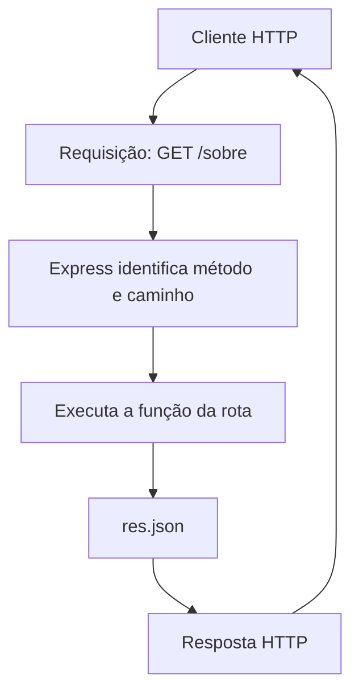

# Tutorial 04 — Introdução às rotas HTTP

**Projeto:** Cadastro de Produtos  
**Versão:** V0001  
**Arquivo:** `04-introducao-rotas-http-V0001.md`  
**Público-alvo:** alunos iniciantes em desenvolvimento back-end  
**Tecnologias:** Node.js, TypeScript e Express  
**Editor:** Visual Studio Code

---

## 1. Objetivos de aprendizagem

Ao concluir este tutorial, você deverá ser capaz de:

- explicar o que é uma rota HTTP;
- reconhecer os principais métodos HTTP;
- criar rotas utilizando o Express;
- identificar uma rota pelo método HTTP e pelo caminho;
- receber parâmetros enviados pela URL;
- retornar respostas no formato JSON;
- utilizar códigos de status HTTP;
- testar diferentes requisições ao servidor.

## 2. Pré-requisitos

Antes de começar, verifique se você:

- concluiu os Tutoriais 02 e 03;
- possui o Node.js e o npm instalados;
- possui o projeto `cadastro-produtos` configurado com TypeScript e Express;
- consegue iniciar o servidor criado no Tutorial 03;
- está utilizando o Visual Studio Code.

> **Importante:** este tutorial parte do servidor funcional criado no Tutorial 03. Não crie outro projeto e não reinstale as dependências.

## 3. O que será construído

Vamos ampliar o servidor para que ele responda a diferentes requisições HTTP.

Ao final, teremos rotas de demonstração como:

| Método | Caminho | Finalidade |
|---|---|---|
| GET | `/` | Apresentar uma mensagem inicial |
| GET | `/sobre` | Apresentar informações sobre a API |
| GET | `/saudacao/:nome` | Receber um nome pela URL |
| POST | `/exemplo` | Demonstrar uma rota de criação |
| PUT | `/exemplo/:id` | Demonstrar uma rota de atualização |
| DELETE | `/exemplo/:id` | Demonstrar uma rota de exclusão |

Essas rotas são exemplos didáticos. Ainda não estamos implementando o cadastro real de produtos.

## 4. Conceitos necessários

### 4.1 O que é uma requisição HTTP?

Quando um cliente precisa obter ou enviar informações para um servidor, ele realiza uma requisição HTTP.

O cliente pode ser:

- um navegador;
- um aplicativo de celular;
- um sistema front-end;
- o Postman;
- outro servidor.

O servidor recebe a requisição, identifica o que foi solicitado e devolve uma resposta.

Exemplo:

1. O cliente solicita `GET /sobre`.
2. O Express procura uma rota que corresponda ao método `GET` e ao caminho `/sobre`.
3. A função associada à rota é executada.
4. O servidor devolve uma resposta.

### 4.2 O que é uma rota?

Uma rota define como o servidor deve responder quando recebe uma requisição com determinado método HTTP e determinado caminho.

No Express, uma rota simples é criada assim:

```typescript
app.get("/sobre", (req, res) => {
    res.json({
        mensagem: "Esta é a API de cadastro de produtos."
    });
});
```

Observe os elementos:

- `app`: representa a aplicação Express;
- `get`: indica o método HTTP esperado;
- `"/sobre"`: indica o caminho da rota;
- `req`: representa a requisição recebida;
- `res`: representa a resposta que será enviada;
- `res.json()`: envia uma resposta no formato JSON.

Uma rota não é identificada somente pelo caminho. O método HTTP também faz parte da identificação.

Por exemplo, `GET /exemplo` e `POST /exemplo` são duas rotas diferentes, mesmo utilizando o mesmo caminho.

### 4.3 Principais métodos HTTP

Os métodos HTTP indicam a intenção da requisição.

| Método | Uso comum | Exemplo no projeto |
|---|---|---|
| GET | Consultar informações | Listar produtos |
| POST | Criar um recurso | Cadastrar um produto |
| PUT | Atualizar um recurso | Atualizar um produto |
| DELETE | Excluir um recurso | Excluir um produto |

Nesta etapa, vamos criar exemplos dos quatro métodos. A implementação efetiva das operações de produtos será realizada nos tutoriais de CRUD.

### 4.4 O que é JSON?

JSON é um formato textual utilizado para representar e transportar dados.

Exemplo:

```json
{
    "mensagem": "Servidor funcionando",
    "projeto": "Cadastro de Produtos",
    "versao": 1
}
```

No Express, podemos utilizar `res.json()` para enviar um objeto JavaScript como resposta JSON.

### 4.5 Códigos de status HTTP

Além do conteúdo, uma resposta HTTP possui um código de status. Ele informa o resultado da requisição.

| Código | Significado | Situação de exemplo |
|---|---|---|
| 200 | OK | Requisição realizada com sucesso |
| 201 | Created | Recurso criado |
| 400 | Bad Request | Requisição inválida |
| 404 | Not Found | Recurso ou rota não encontrado |
| 500 | Internal Server Error | Erro interno no servidor |

Para definir o código de status no Express, podemos utilizar:

```typescript
res.status(201).json({
    mensagem: "Recurso criado."
});
```

A chamada `status()` define o código HTTP. A chamada `json()` envia o conteúdo da resposta.

### 4.6 Parâmetros de rota

Uma rota pode receber informações diretamente pelo caminho da URL.

Observe:

```typescript
app.get("/saudacao/:nome", (req, res) => {
    const nome = req.params.nome;

    res.json({
        mensagem: `Olá, ${nome}!`
    });
});
```

O trecho `:nome` define um parâmetro de rota.

Se o cliente acessar:

```text
http://localhost:3000/saudacao/Janete
```

O Express disponibilizará o valor `Janete` em `req.params.nome`.

O caractere `:` indica que aquela parte do caminho é variável.

Outro exemplo:

```typescript
app.get("/produtos/:id", (req, res) => {
    const id = req.params.id;

    res.json({
        mensagem: "Consulta de produto",
        identificador: id
    });
});
```

Nesse exemplo, `:id` representa um identificador recebido pela URL.

> Neste tutorial, o parâmetro será apenas apresentado e devolvido na resposta. A busca real de um produto pelo identificador será implementada posteriormente.

## 5. Como funciona o atendimento de uma rota?

O diagrama representa uma requisição simples, sem Controller ou Repository.



Nesta etapa, as rotas ficarão diretamente no arquivo `server.ts`. Essa organização é intencional para facilitar a compreensão inicial. A separação das rotas em arquivos próprios será estudada posteriormente.

## 6. Passo a passo

### Etapa 1 — Abrir o projeto

1. Abra o Visual Studio Code.
2. Abra a pasta `cadastro-produtos`.
3. Abra o terminal integrado do VS Code.
4. Confira se o terminal está na pasta do projeto.

Execute:

```bash
dir
```

Você deverá reconhecer arquivos como `package.json` e `tsconfig.json`, além da pasta `src`.

Se necessário, entre na pasta do projeto:

```bash
cd Projetos\cadastro-produtos
```

> O comando acima pressupõe que a pasta `Projetos` esteja no diretório atual. Se você já estiver dentro de `cadastro-produtos`, não execute o comando novamente.

### Etapa 2 — Conferir o servidor atual

Abra o arquivo:

```text
src/server.ts
```

Antes de modificar o arquivo, confira se ele corresponde ao servidor criado no Tutorial 03 e se está funcionando.

Se o servidor ainda não estiver funcionando, retorne ao Tutorial 03 e resolva o problema antes de continuar.

### Etapa 3 — Criar a primeira rota

Vamos criar uma rota para o caminho `/`.

Abra `src/server.ts` e substitua seu conteúdo pelo código completo da seção 7.

A rota inicial será:

```typescript
app.get("/", (req, res) => {
    res.json({
        mensagem: "Bem-vindo à API de Cadastro de Produtos!"
    });
});
```

O caminho `/` representa a raiz do servidor.

### Etapa 4 — Criar uma rota de informações

Adicione ao servidor a rota `/sobre`:

```typescript
app.get("/sobre", (req, res) => {
    res.json({
        projeto: "Cadastro de Produtos",
        tecnologia: "Node.js, TypeScript e Express",
        finalidade: "Projeto didático de desenvolvimento back-end"
    });
});
```

Ao acessar essa rota, o servidor devolverá um objeto JSON com informações sobre o projeto.

### Etapa 5 — Criar uma rota com parâmetro

Agora vamos criar uma rota que recebe um nome pela URL:

```typescript
app.get("/saudacao/:nome", (req, res) => {
    const nome = req.params.nome;

    res.json({
        mensagem: `Olá, ${nome}! Seja bem-vindo(a).`
    });
});
```

Experimente acessar:

```text
http://localhost:3000/saudacao/Janete
```

Depois, substitua `Janete` por outro nome.

Perceba que não precisamos criar uma rota diferente para cada pessoa. O parâmetro `:nome` permite receber valores diferentes.

### Etapa 6 — Demonstrar os métodos POST, PUT e DELETE

Até agora, utilizamos o método GET. Vamos acrescentar três rotas para compreender os outros métodos.

```typescript
app.post("/exemplo", (req, res) => {
    res.status(201).json({
        mensagem: "Exemplo de rota POST.",
        status: "Recurso criado (simulação)"
    });
});

app.put("/exemplo/:id", (req, res) => {
    const id = req.params.id;

    res.status(200).json({
        mensagem: "Exemplo de rota PUT.",
        identificador: id,
        status: "Recurso atualizado (simulação)"
    });
});

app.delete("/exemplo/:id", (req, res) => {
    const id = req.params.id;

    res.status(200).json({
        mensagem: "Exemplo de rota DELETE.",
        identificador: id,
        status: "Recurso excluído (simulação)"
    });
});
```

Essas rotas não criam, atualizam ou excluem dados. Elas apenas demonstram como o Express diferencia os métodos HTTP e como podemos devolver respostas com códigos de status.

Observe que `POST /exemplo`, `PUT /exemplo/10` e `DELETE /exemplo/10` representam requisições diferentes.

### Etapa 7 — Entender o tratamento de rotas inexistentes

Quando uma requisição não corresponde a nenhuma rota cadastrada, o Express responde com o status HTTP `404 Not Found`.

Por exemplo, tente acessar:

```text
http://localhost:3000/rota-inexistente
```

O servidor não possui uma rota correspondente a esse caminho.

Nesta etapa, vamos observar a resposta padrão do Express. Não será necessário criar um middleware próprio de tratamento de erros.

## 7. Código completo do arquivo

Ao terminar as etapas anteriores, o conteúdo completo de `src/server.ts` deverá ser:

```typescript
import express from "express";

const app = express();

const PORT = 3000;

// Rota inicial
app.get("/", (req, res) => {
    res.json({
        mensagem: "Bem-vindo à API de Cadastro de Produtos!"
    });
});

// Rota sobre o projeto
app.get("/sobre", (req, res) => {
    res.json({
        projeto: "Cadastro de Produtos",
        tecnologia: "Node.js, TypeScript e Express",
        finalidade: "Projeto didático de desenvolvimento back-end"
    });
});

// Rota com parâmetro
app.get("/saudacao/:nome", (req, res) => {
    const nome = req.params.nome;

    res.json({
        mensagem: `Olá, ${nome}! Seja bem-vindo(a).`
    });
});

// Demonstração do método POST
app.post("/exemplo", (req, res) => {
    res.status(201).json({
        mensagem: "Exemplo de rota POST.",
        status: "Recurso criado (simulação)"
    });
});

// Demonstração do método PUT
app.put("/exemplo/:id", (req, res) => {
    const id = req.params.id;

    res.status(200).json({
        mensagem: "Exemplo de rota PUT.",
        identificador: id,
        status: "Recurso atualizado (simulação)"
    });
});

// Demonstração do método DELETE
app.delete("/exemplo/:id", (req, res) => {
    const id = req.params.id;

    res.status(200).json({
        mensagem: "Exemplo de rota DELETE.",
        identificador: id,
        status: "Recurso excluído (simulação)"
    });
});

// Inicialização do servidor
app.listen(PORT, () => {
    console.log(`Servidor executando em http://localhost:${PORT}`);
});
```

## 8. Explicação do código

### 8.1 Importação do Express

```typescript
import express from "express";
```

Importamos o Express para utilizar suas funcionalidades na aplicação.

### 8.2 Criação da aplicação

```typescript
const app = express();
```

Criamos uma instância da aplicação Express. É por meio de `app` que registramos as rotas e configuramos o servidor.

### 8.3 Criação de uma rota GET

```typescript
app.get("/sobre", (req, res) => {
    res.json({
        mensagem: "Informações sobre o projeto"
    });
});
```

O método `get()` registra uma rota que será executada quando chegar uma requisição GET para o caminho `/sobre`.

### 8.4 A requisição e a resposta

Os parâmetros `req` e `res` representam objetos fornecidos pelo Express:

- `req`: contém informações sobre a requisição recebida;
- `res`: permite construir e enviar a resposta.

### 8.5 Utilização de parâmetros

```typescript
const nome = req.params.nome;
```

O valor enviado no trecho variável da URL fica disponível em `req.params`.

### 8.6 Definição do código de status

```typescript
res.status(201).json({
    mensagem: "Recurso criado"
});
```

Primeiro definimos o status da resposta e depois enviamos o conteúdo JSON.

### 8.7 Métodos HTTP diferentes

O Express oferece métodos como:

- `app.get()`;
- `app.post()`;
- `app.put()`;
- `app.delete()`.

Cada um registra uma rota associada a um método HTTP específico.

## 9. Arquivos criados ou modificados

| Arquivo | Ação |
|---|---|
| `src/server.ts` | Modificado |
| `package.json` | Nenhuma alteração |
| `tsconfig.json` | Nenhuma alteração |
| `package-lock.json` | Nenhuma alteração |

Não será criada nenhuma pasta nova neste tutorial.

## 10. Como executar

No terminal integrado do VS Code, na pasta raiz `cadastro-produtos`, execute o mesmo comando de desenvolvimento configurado no Tutorial 02.

No ambiente preparado naquele tutorial, o comando esperado é:

```bash
npm run dev
```

A mensagem de inicialização deverá indicar:

```text
Servidor executando em http://localhost:3000
```

Mantenha o terminal aberto enquanto estiver testando as rotas.

Se o comando não for reconhecido, confira os scripts do `package.json` e retorne à configuração do Tutorial 02. Não altere as dependências para resolver um problema de comando.

## 11. Como testar

### 11.1 Testar pelo navegador

O navegador realiza requisições GET ao acessar diretamente uma URL.

Teste:

| URL | Resultado esperado |
|---|---|
| `http://localhost:3000/` | Mensagem de boas-vindas |
| `http://localhost:3000/sobre` | Informações do projeto |
| `http://localhost:3000/saudacao/Janete` | Saudação com o nome Janete |

Observe o conteúdo JSON retornado pelo servidor.

### 11.2 Testar pelo Postman

Para testar métodos diferentes de GET, utilize o Postman ou outro cliente HTTP equivalente.

Crie as seguintes requisições:

| Método | URL | Status esperado |
|---|---|---|
| GET | `http://localhost:3000/` | 200 |
| GET | `http://localhost:3000/sobre` | 200 |
| GET | `http://localhost:3000/saudacao/Janete` | 200 |
| POST | `http://localhost:3000/exemplo` | 201 |
| PUT | `http://localhost:3000/exemplo/10` | 200 |
| DELETE | `http://localhost:3000/exemplo/10` | 200 |
| GET | `http://localhost:3000/rota-inexistente` | 404 |

Para cada teste:

1. Abra o Postman.
2. Selecione o método HTTP indicado.
3. Informe a URL.
4. Clique em **Send**.
5. Confira o status HTTP.
6. Observe o corpo da resposta.

> Não é necessário preencher o Body das requisições POST e PUT. Nesta demonstração, os dados não serão recebidos nem armazenados.

### 11.3 O que observar nos testes?

Compare as requisições:

- O mesmo caminho pode ter rotas diferentes quando o método HTTP muda.
- O parâmetro `:id` pode receber valores diferentes.
- O status HTTP informa o resultado da operação.
- O corpo da resposta contém os dados enviados pelo servidor.
- Uma rota inexistente resulta em status 404.

## 12. Problemas comuns e soluções

| Problema | Possível causa | Solução |
|---|---|---|
| `Cannot GET /sobre` | A rota não foi criada ou o servidor não foi reiniciado | Confira o código e reinicie o servidor |
| `ECONNREFUSED` | O servidor não está em execução | Inicie o servidor no terminal |
| Erro ao importar Express | Dependências ou configuração incorretas | Confira o Tutorial 02 e a instalação |
| A rota retorna 404 | O método ou caminho não corresponde à rota | Confira método e URL |
| O navegador não testa POST | O navegador acessa diretamente por GET | Utilize o Postman |
| O nome não aparece na saudação | O parâmetro da rota foi escrito incorretamente | Confira `:nome` e `req.params.nome` |

## 13. Exercícios para os alunos

### Exercício 1 — Rota de contato

Crie uma rota GET com o caminho `/contato`.

Ela deverá retornar um JSON contendo:

- nome do projeto;
- disciplina;
- uma mensagem de contato fictícia.

### Exercício 2 — Rota de apresentação

Crie uma rota GET com o caminho `/aluno/:nome`.

Ela deverá receber o nome pela URL e retornar uma mensagem de apresentação.

Teste com pelo menos três nomes diferentes.

### Exercício 3 — Rota de status

Crie uma rota GET com o caminho `/status`.

Ela deverá retornar um JSON com:

- situação do servidor;
- nome da aplicação;
- código de status 200.

### Exercício 4 — Comparação dos métodos

Utilizando o Postman, teste as rotas `/exemplo` com os métodos POST, PUT e DELETE.

Registre:

- método utilizado;
- caminho acessado;
- código de status recebido;
- mensagem retornada.

Explique por que essas requisições são diferentes.

## 14. Critérios de conclusão

Considere este tutorial concluído quando você conseguir:

- [ ] explicar o conceito de rota HTTP;
- [ ] diferenciar GET, POST, PUT e DELETE;
- [ ] criar rotas no Express;
- [ ] retornar respostas JSON;
- [ ] utilizar códigos de status HTTP;
- [ ] receber parâmetros com `req.params`;
- [ ] testar rotas pelo navegador e pelo Postman;
- [ ] identificar uma resposta 404.

## 15. Questionário de revisão

Responda às questões antes de consultar o gabarito.

### Questão 1

O que é uma rota em uma aplicação Express?

A) Um arquivo utilizado para armazenar dados.  
B) Uma definição de como responder a uma requisição HTTP.  
C) Uma conexão com o banco de dados.  
D) Uma função utilizada exclusivamente para iniciar o servidor.

### Questão 2

Qual método HTTP é normalmente utilizado para consultar informações?

A) POST  
B) DELETE  
C) GET  
D) PUT

### Questão 3

Qual método HTTP é normalmente utilizado para criar um recurso?

A) GET  
B) POST  
C) PUT  
D) DELETE

### Questão 4

No código abaixo, qual é a função de `:nome`?

```typescript
app.get("/saudacao/:nome", (req, res) => {
    // ...
});
```

A) Indicar uma variável de ambiente.  
B) Definir um parâmetro de rota.  
C) Criar uma nova tabela.  
D) Definir o código de status.

### Questão 5

Como podemos acessar o parâmetro `nome` recebido pela URL?

A) `req.body.nome`  
B) `res.params.nome`  
C) `req.params.nome`  
D) `app.nome`

### Questão 6

Qual método do Express envia uma resposta no formato JSON?

A) `res.json()`  
B) `req.json()`  
C) `app.json()`  
D) `res.route()`

### Questão 7

Qual código de status representa uma resposta de sucesso indicando que um recurso foi criado?

A) 200  
B) 201  
C) 404  
D) 500

### Questão 8

O que significa o código HTTP 404?

A) O servidor iniciou corretamente.  
B) O recurso ou caminho solicitado não foi encontrado.  
C) O recurso foi criado.  
D) A requisição foi atualizada.

### Questão 9

Considere as requisições:

- `GET /exemplo`
- `POST /exemplo`

Elas representam:

A) A mesma rota, obrigatoriamente.  
B) Duas requisições diferentes, pois utilizam métodos HTTP diferentes.  
C) Duas requisições inválidas.  
D) Uma rota e uma conexão com o banco de dados.

### Questão 10

Qual é a finalidade de `res.status(201).json({...})`?

A) Criar uma pasta no projeto.  
B) Definir o status HTTP 201 e enviar uma resposta JSON.  
C) Receber um parâmetro da URL.  
D) Reiniciar o servidor.

---

## 16. Gabarito — uso do professor

> **Atenção:** esta seção deve ser removida ou separada antes de disponibilizar a versão do questionário aos alunos.

| Questão | Resposta | Justificativa |
|---|---|---|
| 1 | B | A rota define como responder a uma requisição. |
| 2 | C | GET é utilizado normalmente para consulta. |
| 3 | B | POST é utilizado normalmente para criação. |
| 4 | B | `:nome` define um parâmetro de rota. |
| 5 | C | Os parâmetros de rota são acessados por `req.params`. |
| 6 | A | `res.json()` envia uma resposta JSON. |
| 7 | B | 201 significa Created. |
| 8 | B | 404 significa Not Found. |
| 9 | B | O método HTTP faz parte da identificação da rota. |
| 10 | B | `status(201)` define o status e `json()` envia o conteúdo. |

## 17. Resumo e preparação para o próximo tutorial

Neste tutorial, aprendemos que uma aplicação Express pode possuir várias rotas, cada uma associada a um método HTTP e a um caminho.

Também aprendemos a:

- criar rotas com `app.get()`, `app.post()`, `app.put()` e `app.delete()`;
- receber parâmetros da URL com `req.params`;
- retornar dados em JSON;
- definir códigos de status com `res.status()`;
- testar requisições utilizando o Postman.

### O que ainda não foi implementado?

Neste momento:

- não existe uma classe `Produto`;
- não existe um Repository;
- não existe um array de produtos;
- não existe um Controller;
- as rotas POST, PUT e DELETE são apenas demonstrações;
- não estamos recebendo dados pelo corpo da requisição.

Esses elementos serão introduzidos gradualmente nos próximos tutoriais.

### Próximo tutorial

**Tutorial 05 — Model, classes e orientação a objetos**

No próximo tutorial, vamos estudar classes e objetos em TypeScript e criar a classe `Produto`, que representará os produtos do nosso sistema.

---

**Projeto:** Cadastro de Produtos  
**Stack:** TypeScript + Node.js + Express  
**Tutorial:** 04 — Introdução às rotas HTTP  
**Versão:** V0001
